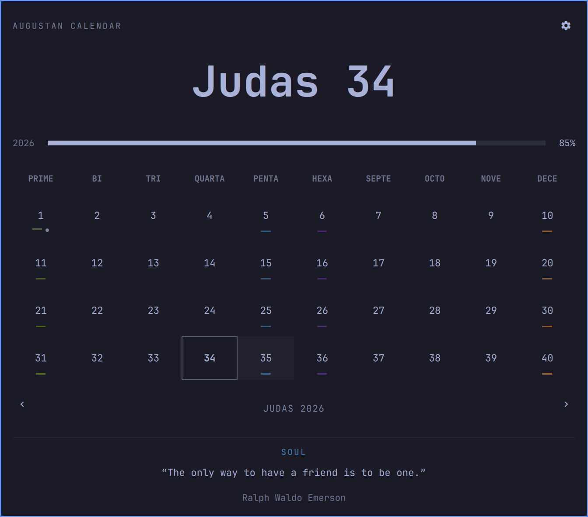

# Omarchy Augustan Calendar

A native Omarchy shell plugin with an Augustan decimal clock, a ten-day calendar, a year progress bar, quiet day markings, and reflections for Spirit, Soul, Mind and Body days.

The calendar opens inside Omarchy. It needs no browser, web server, account, or network connection. Theme, fonts, panel borders, motion and layout direction follow the shell.



## What is the Augustan calendar?

The Augustan calendar is an alternative calendar created by Austin Wilkerson. It keeps the familiar length of a day and year, but gives them a different rhythm: ten-day weeks, nine regular 40-day months, and a short festival month at the end of the year.

It also uses decimal time. Instead of 24 hours, a day has 10 hours, each containing 100 minutes of 100 seconds. Conventional noon is **5:00:00**. The same moment can be shown as a percentage of the day: **7:95:45** is approximately **79.5%**. The day still begins at local midnight.

Four days of each ten-day week invite a different focus: **Spirit**, **Soul**, **Mind**, and **Body**. The calendar marks them gently in green, blue, purple, and brown, and offers a short quote from Scripture, writers, or thinkers. Ordinary days leave that space quiet. Religious observances and day markings can be switched off independently; quotes have their own switch.

The month names default to disciples, from Petras through Thomas. Numerical and seasonal names are available in settings. Thomas is the closing festival period, including Christmas and, when needed, Leap Day. The full rules and observances are described below.

You can try this alongside your regular Gregorian clock. Nothing requires you to replace your existing calendar or adopt the system to explore it. The [original Augustan Calendar project](https://github.com/austinwilkerson/Augustan-Calendar) provides the companion browser calendar.

## Install

Requires Omarchy's Quickshell-based shell with `omarchy plugin` support. Runtime dependencies are Qt Quick, Quickshell, and Omarchy's shared shell components, supplied by Omarchy. The optional installer uses Bash, Git, and standard file utilities. No additional packages, network services, or API keys are needed at runtime.

```bash
omarchy plugin add https://github.com/austinwilkerson/omarchy-augustan-calendar --enable --yes
omarchy bar move io.github.austinwilkerson.augustan --before omarchy.clock
```

Or clone this repository and run `bash install.sh`. Its optional argument selects `centerBegin` (default, left of the regular clock), `centerEnd` (right of it), `left`, `right`, `center`, or `tray`. The plugin follows a vertical bar too. The regular clock remains part of a centered pair, and its format is preserved.

The installer backs up any existing copy under `~/.local/state/omarchy/augustan-backups/` (respecting XDG paths). When replacing the original web-link prototype, a shell restart may be needed once: `omarchy restart shell`.

## Use

- **Left-click** opens the native calendar.
- **Right-click** cycles through nine display formats and saves the selection.
- **Gear** opens settings for month names, day markings, quotes, and bar placement.
- **Click a day** to see its observances and, on themed days, its reflection.
- **Click the large date**, press **Home** or **Enter** to return to today.
- **Left/Right** browse months; **Up/Down** browse years.
- **Escape** leaves settings, then closes the calendar. Clicking outside also closes it.
- Settings and day cells can be reached with **Tab** and activated with **Space/Enter**.

The default bar label is `Petras 1 7:95`. Alternatives show weekday/time, weekday/time with seconds, time alone, date/week/year, numeric date/time, date/day percentage, or day percentage alone. There is no AM/PM. `7:95:45` is `79.5%` of the day (one decimal place, capped at 99.9% before midnight).

## Calendar and reflections

Nine 40-day months each contain four ten-day weeks. Thomas has five festival days, plus Leap Day when the **following Gregorian year** is leap. December 25, 2023 is Thomas 5; December 26 is Thomas 6; December 27 is Petras 1, 2024. Gregorian century exceptions apply.

The four weekly themes fall on days 1 (Spirit), 5 (Soul), 6 (Mind), and 10 (Body), repeated every ten days. Thomas 1–4 carry those four themes; Christmas and Leap Day have no weekly theme. Weeks are numbered 1–36; Thomas has no regular week number.

Two independent settings control weekly special-day markings and high holy/religious observances. A line marks a themed day; a dot marks a holy day or observance. Hover for its name or select it for details. Hiding markings does not change quote preferences.

The local quote collection mixes Scripture, writers and thinkers, with author attribution only. Quotes appear for the selected themed day; the area disappears on ordinary days. Opening always selects today. Eight initial quotes are bundled; add more in `Quotes.js`. Provenance is in [SOURCES.md](SOURCES.md).

Time follows local civil time, including daylight saving changes. A day contains 10 hours × 100 minutes × 100 seconds, so one Augustan second is 0.864 conventional seconds. Calendar arithmetic uses civil-day ordinals to prevent daylight saving date drift.

## Settings and updates

Preferences live in this widget's entry in `~/.config/omarchy/shell.json`. The built-in settings panel writes them through Omarchy's settings API. Git-installed copies can be updated with `omarchy plugin update io.github.austinwilkerson.augustan --yes`. For a copy installed by `install.sh`, pull the source and rerun that installer.

Remove it with `omarchy plugin remove io.github.austinwilkerson.augustan --yes`. The Gregorian clock is independent.

## Verify

```bash
TZ=America/Louisville node tests/calendar.cjs
TZ=UTC node tests/calendar.cjs
omarchy plugin validate .
bash -n install.sh
```

Tests cover every calendar day from 1999 through 2401, leap and century boundaries, time conversion, all display formats, month navigation, observances, quote availability, ordinary-day hiding, year progress and tooltip escaping.

For local integration, `omarchy-shell io.github.austinwilkerson.augustan.calendar status` reports panel state. The same IPC target offers `settings`, `cycleFormat`, `today`, `nextMonth`, `previousMonth`, and `selectDay <number>`. Open/close/toggle use `omarchy-shell io.github.austinwilkerson.augustan open` (or `close`/`toggle`).

MIT licensed. Quotes retain their original public-domain provenance.

## Version 1.1

Right-click includes month/day/time with and without seconds and month/day/day-percentage formats. Hours run from 0 through 9 without a leading zero. Settings offer disciple (default), numerical, and seasonal month names and omit the redundant format picker. Quote theme headings and day underlines share their assigned fixed colors. Beside-clock placements center both clocks as one group and display a `|` between them.
